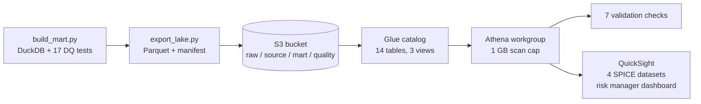

# The mart on AWS: S3, Athena, QuickSight

The same mart, served from an S3 data lake, queried with Athena, with the risk-manager view rebuilt
in QuickSight. One command deploys it, one command removes it.



```bash
pip install -r requirements.txt
aws configure                          # or use --profile
python aws/deploy.py --dry-run         # rehearse offline first: no credentials, no AWS calls
python aws/deploy.py                   # S3 + Athena + QuickSight, about 2-3 minutes
python aws/teardown.py                 # delete everything it created
```

## Why Athena, not Redshift Serverless

The lake is 12 MB. Athena charges per data scanned ($5 per TB), so a full deploy, including every
validation query, costs about $0.0001, and it costs nothing while idle. Redshift Serverless bills compute
time instead. Its free trial is $300 of credit that has to be used within 90 days of sign-up, and an
idle data warehouse is the wrong tool for six months of snapshots anyway. If the mart grew to billions of
rows with many concurrent dashboard users, Redshift would be the better choice.

## What gets created

| Resource | Name | Notes |
|---|---|---|
| S3 bucket | `credit-risk-mart-<account>-<region>` | Encrypted, public access blocked, HTTPS only; Athena results expire after 7 days |
| Glue database | `credit_risk_mart` | 14 tables + 3 views (created by `deploy.py` through Athena DDL) |
| Athena workgroup | `credit-risk-mart` | Engine v3; any query scanning > 1 GB is cancelled |
| IAM role | stack-generated | Trusted by QuickSight; reads only this bucket, database and workgroup |
| QuickSight | `credit-risk-mart-*` | Athena data source, 4 SPICE datasets, analysis, dashboard |

S3 layout (`output/lake/` mirrors it):

```
raw/uci_credit_card/UCI_Credit_Card.csv           source file, unchanged (table raw_uci_credit_card)
source/stg_credit_raw/data.parquet                typed source
mart/fact_account_month/month_key=2005-04/...     snapshot fact, one partition per month (partition projection)
mart/<dimension or metric table>/data.parquet     9 more mart tables
quality/dq_results/data.parquet                   the build's data-quality results
manifest.json                                     row counts, columns, SHA-256 of every file
```

## Athena

`deploy.py` creates the tables from `athena/01_tables.sql`, which `export_lake.py` generates from the
Parquet files it writes, so the column types always match the files. It then creates three views
(`athena/02_views.sql`) that recompute metrics from the snapshot in Athena:
- `v_delinquency_by_month`: accounts and exposure 30/60/90+ days past due
- `v_roll_rates`: bucket-to-bucket transitions
- `v_default_by_limit_and_bucket`: a two-way cut the mart doesn't store

It then runs `athena/03_checks.sql`, and the deploy stops if any of these checks fails:

| Check | Proves |
|---|---|
| A1 | The raw CSV in S3 has 30,000 unique accounts |
| A2 | Each of the 6 snapshot partitions has 30,000 rows |
| A3 | Monthly balances and payments in the snapshot = the raw CSV |
| A4 | Roll rates recomputed in Athena = the mart's table (80 transitions) |
| A5 | Delinquency recomputed in Athena = the mart's table |
| A6 | 6,636 of 30,000 accounts defaulted (22.12%) |
| A7 | The build passed every blocking data-quality test |

`athena/examples.sql` has five analyst queries to try in the console, including the roll-rate matrix
and the status-code counts that expose the September 2005 coding break.

## QuickSight

QuickSight is the only part that costs money. It has a free trial: "all features for 30 days for up to
25 users per account". After that, an Author is $24 a month. Don't make yourself an **Author Pro** (or
turn on Q&A), because that adds a $250/month account fee.

1. **Sign up once, in the console.** Open Amazon Quick Sight in the AWS console and sign up in the
   region you deploy to (default `us-east-1`). Choose a plain Author for yourself. You don't need to
   grant S3 or Athena access during sign-up, because the data source uses the IAM role the stack
   creates.
2. **Run `python aws/deploy.py`.** It finds your admin user and builds the following:
   - the Athena data source
   - four SPICE datasets: portfolio by month, roll summary, roll rates, default by segment
   - the analysis and dashboard **Credit risk mart - risk manager view**
3. **Open the dashboard** at the URL the script prints. It has:
   - Month and Segment controls
   - four KPIs: 30+ rate, 90+ rate, current-to-delinquent roll rate, default rate
   - the delinquency trend
   - the roll-rate matrix for the selected month
   - default rate by segment
   - a note on the September coding break

The dashboard is defined in code (`quicksight_view.py`) and versioned with the repo. Every request is
checked offline against the QuickSight API model. QuickSight applies a few rules only when it renders
the dashboard, though. If deploy reports a visual error, build that visual by hand from the matching
item below and keep the rest:

| Visual | Dataset | Fields | Filter |
|---|---|---|---|
| KPI 30+ / 90+ | portfolio | `rate_30plus` / `rate_90plus` (max), % format | `month_key` = Month parameter |
| KPI roll rate | rollsummary | `current_to_delinquent` (max) | `to_month` = Month parameter |
| KPI default rate | segments | calculated field `sum({defaults}) / sum({accounts})` | `segment_type` = "Sep 2005 bucket" |
| Line | portfolio | X `month_label` sorted by `month_index`; values the three rates | none |
| Pivot | rollrates | rows `from_bucket`, columns `to_bucket` (sort by `from_order`/`to_order`), value `roll_rate` (sum) | `to_month` = Month parameter |
| Bar (horizontal) | segments | Y `segment_value` sorted by `sort_order`; value `default_rate` | `segment_type` = Segment parameter |

When you're done, run `python aws/teardown.py`. It removes the QuickSight assets, empties the bucket
and deletes the stack. To stop QuickSight billing as well, unsubscribe in QuickSight's account
settings before the trial ends.

## Cost

| Service | This project |
|---|---|
| S3 | 12 MB: under $0.01 a month |
| Athena | about 40 queries per deploy, a few MB scanned: about $0.0001 |
| Glue Data Catalog | 15 objects: within the free 1 million |
| CloudFormation, IAM | free |
| QuickSight | 30-day free trial, then $24 per Author per month; SPICE use (under 1 MB) is inside the Author's included 10 GB |

## Permissions needed to deploy

An IAM identity that can manage CloudFormation, S3, Glue, Athena, IAM roles (the stack creates one, so
`CAPABILITY_IAM`), and QuickSight, and pass the QuickSight role (`iam:PassRole`). An account
administrator has all of these.

## Tested without an AWS account

- `tests/test_athena_sql.py`: every Athena statement parses as Trino (Athena engine v3) SQL, and the
  views, checks and example queries run in DuckDB against the exact files that get uploaded.
- `tests/test_aws_deploy.py`: deploy, re-deploy and teardown run against a fake account. Every one
  of the roughly 170 AWS requests is validated against botocore's service model. The second deploy
  must update in place without re-uploading anything, and teardown must leave nothing behind.
- `cfn-lint aws/infra.yaml`.

Sources: [Athena pricing](https://aws.amazon.com/athena/pricing/),
[Redshift free trial](https://aws.amazon.com/redshift/free-trial),
[Quick Sight pricing](https://aws.amazon.com/quicksuite/quicksight/pricing),
[Quick Sight FAQs](https://aws.amazon.com/quicksuite/quicksight/faqs/) (checked October 2026).
